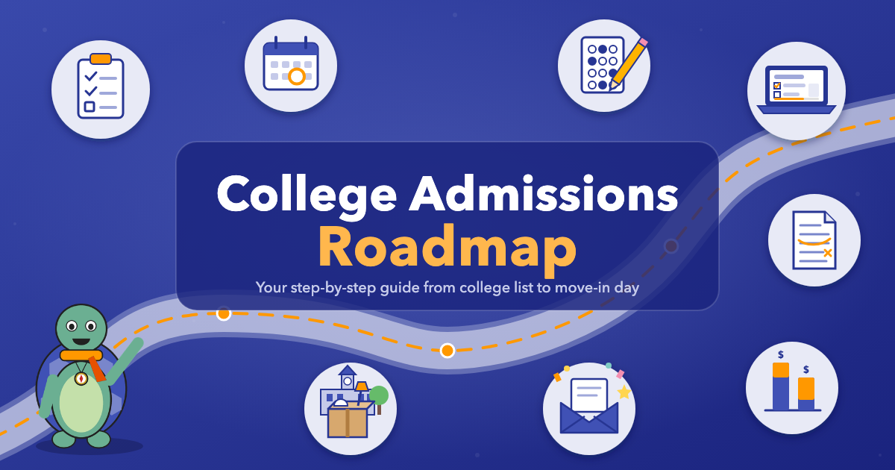

# College Admissions Roadmap

<figure markdown>
  { width="100%" }
</figure>

Applying to college can feel like a giant project with no instructions. This book is the instructions. It walks you through the whole process, one step at a time, from your first college list in the summer before senior year to move-in day the following fall.

It's written to you, the student, and it assumes you're starting from zero. Parents, guardians and school counselors can read along too.

## Where to Start

- **Just getting started?** Read [The College Landscape and Application Rounds](chapters/01-college-landscape-and-rounds/index.md) for a map of the whole process, then do the five first steps at the end of [Getting Organized](chapters/05-getting-organized/index.md).
- **Have a deadline coming up?** Jump straight to the chapter you need. Every chapter stands on its own.
- **Holding an award letter?** Go to [Comparing Award Letters](chapters/16-comparing-award-letters/index.md).
- **Feeling overwhelmed?** Read [Waiting and Managing Anxiety](chapters/17-waiting-and-anxiety/index.md). Uncertainty is a normal part of this, and it takes months, not days.

## What's Inside

- **20 chapters** that follow the order of senior year
- **50 interactive MicroSims** that let you try the ideas with your own numbers, like calculating your GPA, plotting your test score against a college's range, or comparing award letters
- **A 10-question quiz** and **10 annotated references** for every chapter
- **A [Glossary](glossary.md)** of 342 terms in plain language
- **An [FAQ](faq.md)** with 87 common questions and answers
- **A running example:** a senior named Emily works through the process in most chapters, and the book ends with a complete application roadmap for one real school, the University of Iowa

## The Chapters

**Laying the Groundwork**

1. [The College Landscape and Application Rounds](chapters/01-college-landscape-and-rounds/index.md)
2. [How Colleges Evaluate Applicants](chapters/02-how-colleges-evaluate/index.md)
3. [Finding Your Fit](chapters/03-finding-your-fit/index.md)
4. [Researching and Narrowing Your College List](chapters/04-researching-your-list/index.md)
5. [Getting Organized](chapters/05-getting-organized/index.md)

**Testing and Academics**

6. [The SAT and ACT Question](chapters/06-sat-act-question/index.md)
7. [Your Senior Year Course Load](chapters/07-senior-year-course-load/index.md)

**Building the Application**

8. [Activities and Resume](chapters/08-activities-and-resume/index.md)
9. [The Personal Essay](chapters/09-personal-essay/index.md)
10. [Supplemental Essays](chapters/10-supplemental-essays/index.md)
11. [Letters of Recommendation](chapters/11-letters-of-recommendation/index.md)
12. [Filling Out the Common App and Coalition App](chapters/12-common-app-coalition-app/index.md)
13. [Interviews](chapters/13-interviews/index.md)

**Paying for College**

14. [Understanding Financial Aid](chapters/14-understanding-financial-aid/index.md)
15. [Scholarships](chapters/15-scholarships/index.md)
16. [Comparing Award Letters](chapters/16-comparing-award-letters/index.md)

**Decisions and the Finish Line**

17. [Waiting and Managing Anxiety](chapters/17-waiting-and-anxiety/index.md)
18. [Handling Decisions](chapters/18-handling-decisions/index.md)
19. [Making Your Final Choice](chapters/19-making-your-final-choice/index.md)
20. [Getting Ready for Fall](chapters/20-getting-ready-for-fall/index.md)

## How to Use This Book

- Use the menu on the left to move between chapters. Each chapter has its **Content**, a **Quiz** and **Annotated References**.
- Use the search bar at the top of any page to find a term.
- Try the MicroSims as you reach them. They're the fastest way to see how an idea applies to you. You can also browse all of them on the [MicroSims](sims/index.md) page.
- Policies, dates and dollar amounts change every year. Always confirm details on each college's website and on [studentaid.gov](https://studentaid.gov/).

The book is free and open. Learn more [about this book](about.md).
